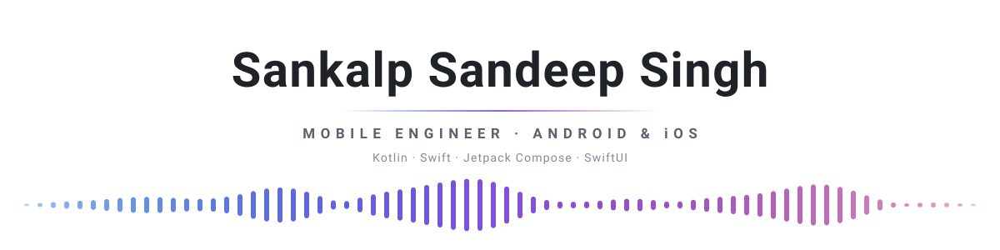

<picture>
  <source media="(prefers-color-scheme: dark)" srcset="assets/header-dark.svg">
  <source media="(prefers-color-scheme: light)" srcset="assets/header-light.svg">
  
</picture>

  

 

 

## 

I've built the **same audio-streaming product twice** — once in Kotlin, once in Swift.

That means every product decision got made twice, against two different frameworks. Sometimes the honest answer was that one platform has no equivalent, and the screen should work differently there rather than pretend.

The hard part of streaming was never the UI. It's playback that survives backgrounding, call interruptions, Bluetooth route changes and a network that drops mid-buffer.

 

## Selected work

<table>
<tr>
<td width="50%" valign="top">

### [smart-calories](https://github.com/sankalp047/smart-calories)

`Swift` · `SwiftUI` · `CoreBluetooth` · `HealthKit`

Nutrition and body-composition tracking across iPhone, Apple Watch and the Home Screen.

**13,300 lines · zero third-party dependencies.**

Pairs with Bluetooth kitchen scales that implement *no standard profile* — recovering their byte layout from two known weights, in about twenty seconds.

</td>
<td width="50%" valign="top">

### [engineering-notes](https://github.com/sankalp047/engineering-notes)

`Architecture` · `Media3` · `Swift Concurrency`

Write-ups on production work whose source isn't mine to publish. Patterns and public APIs only.

**Why four media bugs were one bug.** Collapsing an app to a single player — what it buys, what it costs.

**Kotlin `Flow` → Swift Concurrency.** The obvious mapping is wrong in four specific ways.

</td>
</tr>
</table>

 

## What I work on

<table>
<tr>
<td width="33%" valign="top">

**Media pipelines**

Media3 `MediaLibraryService` and `MediaSession`, background playback, lock-screen and notification controls, Android Auto.

</td>
<td width="33%" valign="top">

**Device integration**

BLE GATT, HealthKit, WatchConnectivity, WidgetKit, Live Activities.

</td>
<td width="33%" valign="top">

**Both platforms**

Kotlin/Compose and Swift/SwiftUI, including porting a `Flow` architecture onto Swift Concurrency.

</td>
</tr>
</table>

 

<b>On native vs. cross-platform</b>

 

I've shipped Flutter and React Native, then rewrote one of those apps natively from scratch — so the opinion is earned rather than inherited.

The rewrite replaced 19 pub packages and 54 CocoaPods with **zero** dependencies. That wasn't austerity for its own sake: removing the dependency layer removed a whole class of problem. No plugin bridges to debug, no `pod install` dependency cycles, no waiting on a maintainer when an OS release breaks something.

It also forced better decisions downstream. With no Combine wrapper to reach for, state became `@Observable` and views re-render narrowly. With no ORM, persistence became plain JSON and the store layer got small enough to read in one sitting — a trade that would be wrong at a hundred thousand rows, and is right at this product's scale.

Cross-platform earns its keep when the product is mostly forms over an API and the team is small. It costs more than it saves the moment you need the platform's own capabilities — background audio, health data, widgets, watch apps — because that's precisely where the abstraction leaks and you end up writing the native code anyway, twice, through a bridge.

 

## Elsewhere

**Publication** — Co-author of a peer-reviewed county-level COVID-19 dataset covering all 3,142 US counties.

**Education** — M.S. Computer Science, University of Texas at Arlington.

**Shipped** — BigFan (Android · Kotlin, Compose, Media3) · Radio Sangam · FPK Pass.

 

Fort Worth, Texas · [sankalpsandeepsingh@gmail.com](mailto:sankalpsandeepsingh@gmail.com) · [LinkedIn](https://linkedin.com/in/sankalpsandeepsingh)

